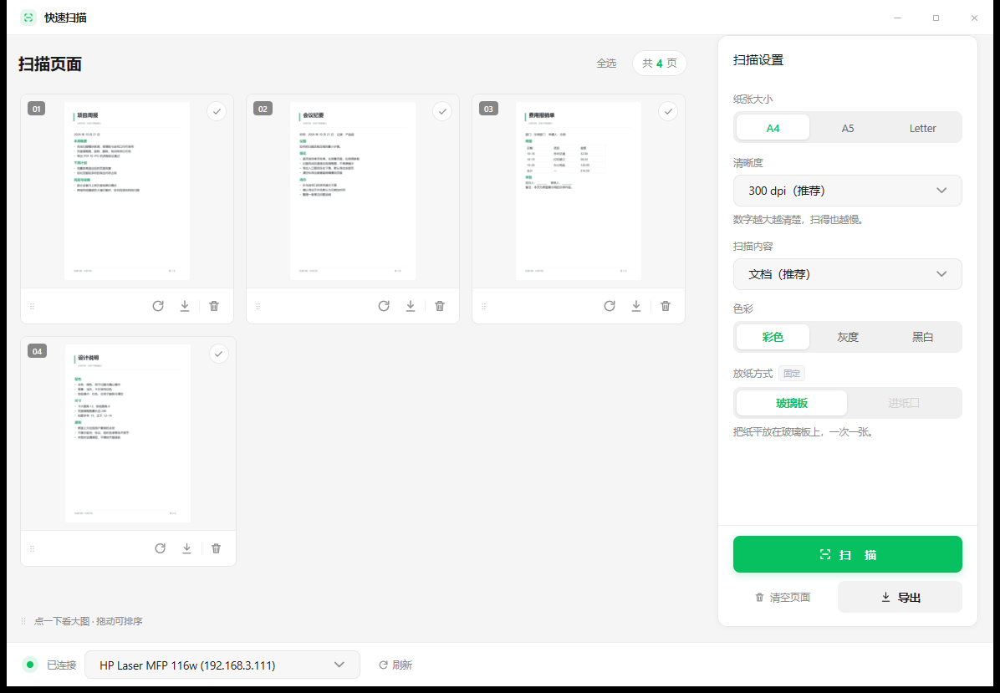
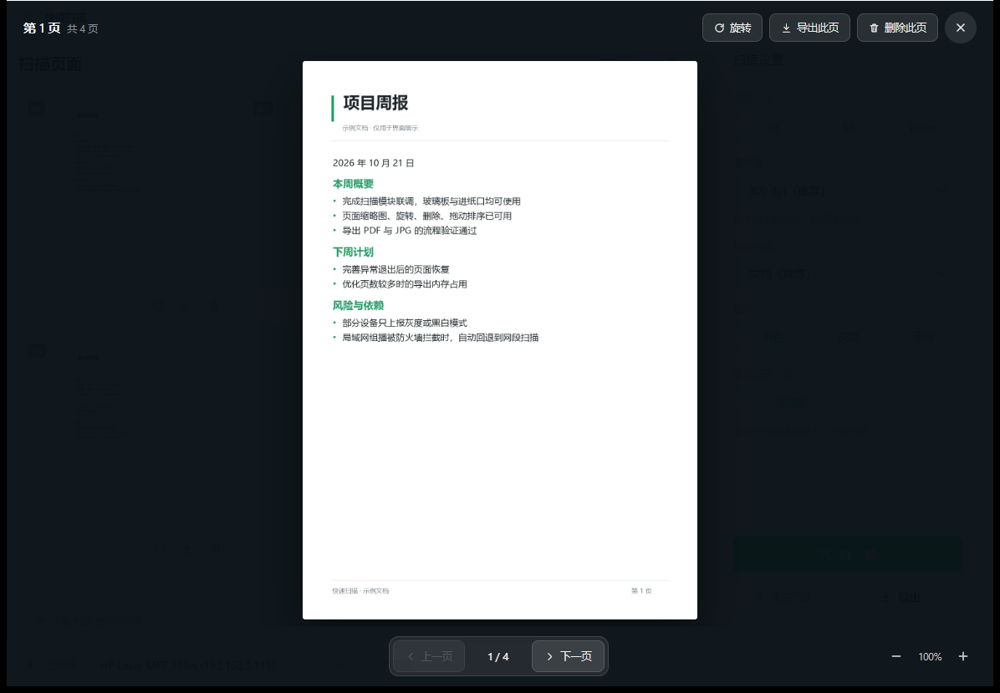

# quick-scan

一个快速的 Windows 扫描工具：放纸 → 扫描 → 导出 PDF / JPG。



扫描走局域网 eSCL（AirPrint 同款协议），不用装厂商驱动。打印机和电脑连同一个 Wi-Fi / 网段即可。

## 功能

- 自动发现局域网里的扫描仪，也能记住上次用的那台
- 玻璃板单张扫描，或进纸口整叠自动逐张扫
- 页面管理：点开大图、翻页、旋转、删除、拖动排序
- 纸张大小、清晰度、色彩、扫描内容按设备能力自动切换
- 导出成一个 PDF 或每页一张 JPG，文件名可用识别出的标题



## 使用

1. 打开 `sscan.exe`
2. 在底部选择打印机（状态点变绿表示连得上）
3. 把纸放好，点右侧「扫描」
4. 扫完点「导出」，选 PDF 或图片

## 运行要求

Windows 10 / 11（64 位）。打印机需要支持 eSCL / AirPrint 扫描，并与电脑在同一网段。

## 构建

需要 Go 1.27+、Rust（OCR 静态库）、LLVM `clang` 和 binutils `windres`。

```powershell
just build      # 产物：sscan.exe
just upx        # 可选：UPX 压缩发布版（dist\sscan.exe，体积约一半，启动多约 0.2 秒）
just test       # 单测，不需要真机
just run        # 构建并启动
```

程序不写注册表、不建配置目录。临时文件放在 `%TEMP%\sscan_<pid>\`，退出时清理。

## 目录

- `cmd/sscan/` 程序入口、窗口生命周期
- `internal/ui/` 界面与交互
- `internal/scanner/` eSCL 发现、扫描、导出、OCR
- `internal/platform/` 临时目录、内嵌模型、控制台脱离

