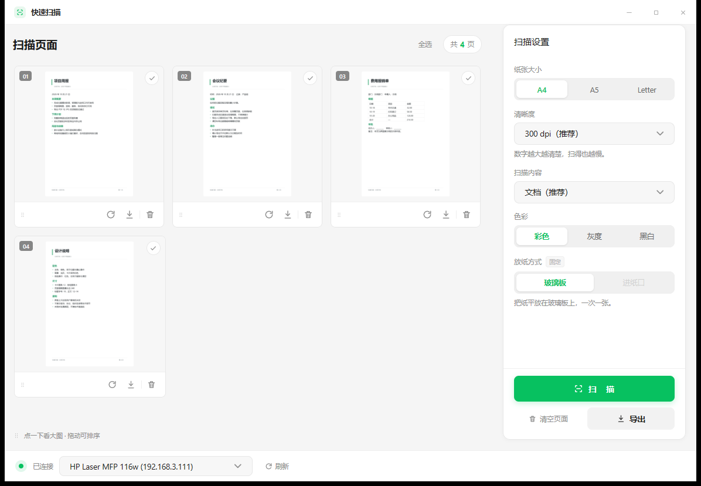
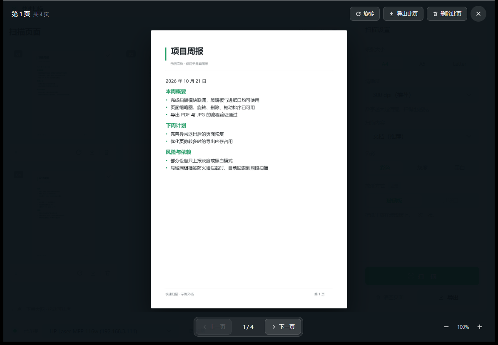

# 快速扫描（quick-scan）

Windows 上的局域网扫描工具。放纸、点扫描、导出 PDF 或 JPG，不用装厂商驱动，打印机和电脑在同一个网段即可。



## 功能

- 自动发现同一网段里的扫描仪，用过的会记住
- 玻璃板单张扫描，或从进纸口整叠逐张扫描
- 页面可以看大图、旋转、删除、拖动排序，也可以只导出勾选的那几页
- 扫描参数按设备上报的能力列出，默认值开箱即用
- 扫描件自动优化：铺平灰底、加深文字，强度可选轻 / 标准 / 强；原始扫描会一并保留，导出时可切回原图
- 导出为一个 PDF 或每页一张 JPG，文件名可用 OCR 识别出的标题
- 程序意外退出后，下次启动可以恢复未导出的页面
- 启动后后台检查新版本，右下角版本号里可以手动检查更新



## 使用

1. 双击 `quick-scan.exe`
2. 在底部选择打印机，状态点变绿表示已连接
3. 放好纸，点右侧「扫描」
4. 扫完点「导出」，选 PDF 或图片

## 运行要求

64 位的 Windows 10 / 11，打印机支持 eSCL 或 AirPrint 扫描。

## 构建

需要 Go 1.27+、Rust、LLVM `clang`。安装包和更新包交给官方 `mygo build`
（Windows 上会自动下载 NSIS）。版本号只写在 `mygo.json`。

```powershell
just build      # 产物：dist\windows-amd64\quick-scan.exe 和安装包
just test       # 单测，不需要真机
just run        # 开发时构建并启动
```

发版流程见 [RELEASE.md](RELEASE.md)。

## 版权

xiyaowong · MIT

